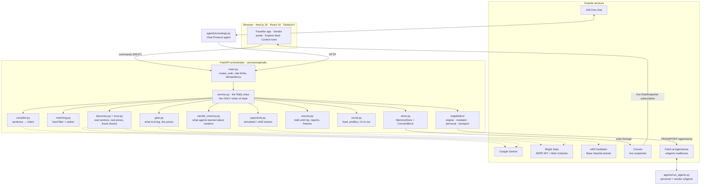
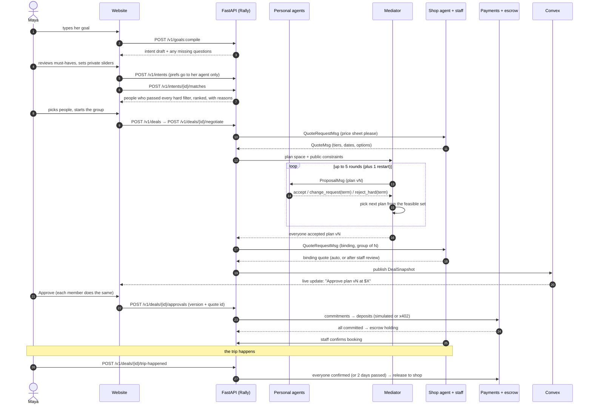
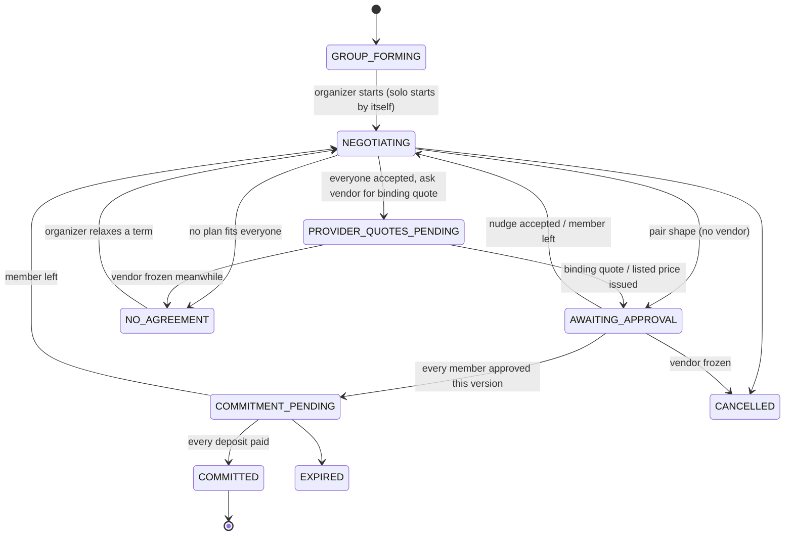
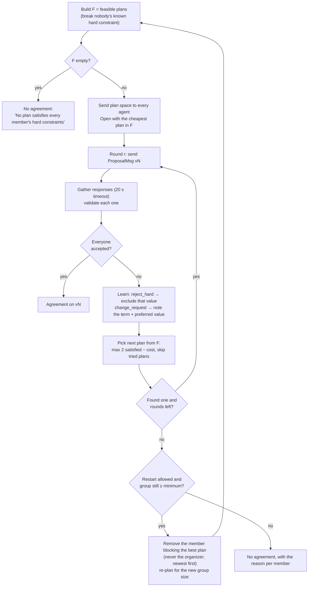
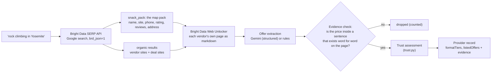
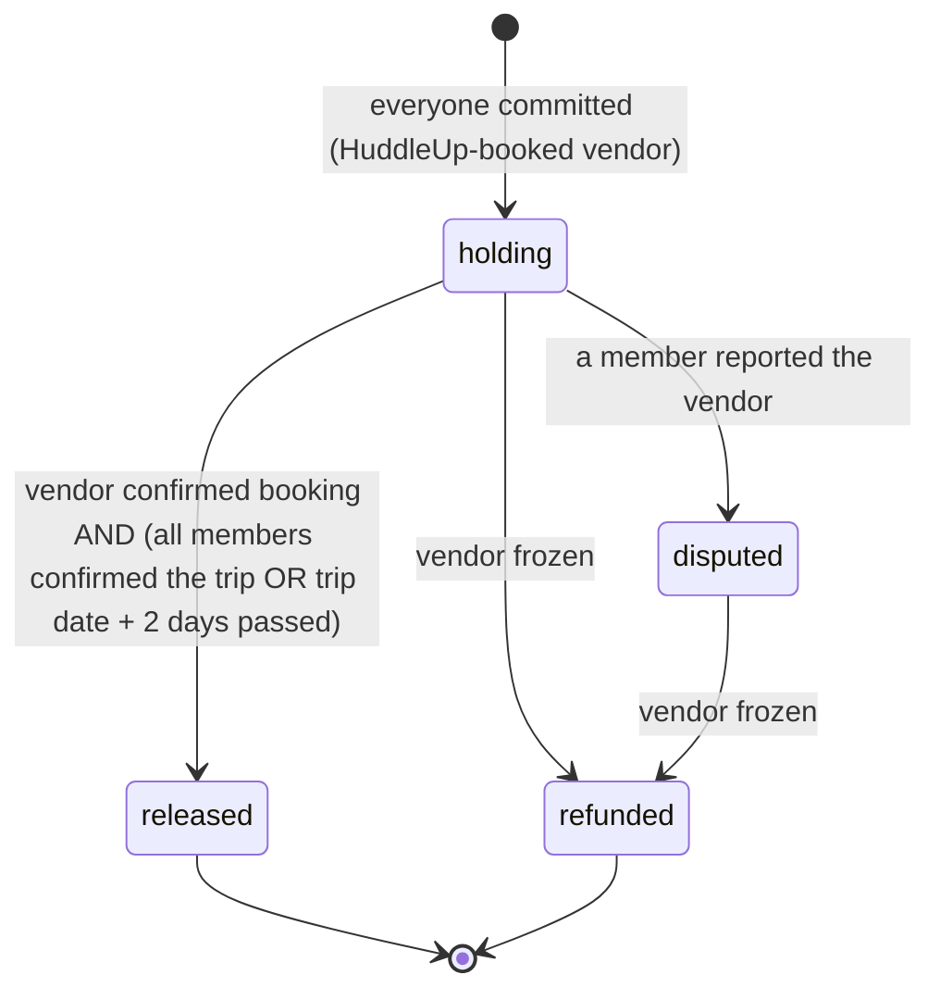
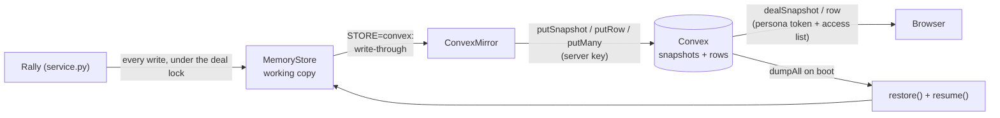

# HuddleUp

**Say what you want to do: any sport, class or adventure, anywhere. Your AI agent finds people to go with, finds real shops and their real prices, bargains for you, and holds your money until the trip has actually happened.**

Built at **Cal Hacks 13.0** by Kevin (website, payments, hosting), Parikshit (AI agents and Fetch.ai) and Dev (AI, search and data).

```bash
python scripts/rally.py setup     # once
python scripts/rally.py dev       # then open http://localhost:3000
```

---

## Contents

**Part 1: The simple version**
- [What HuddleUp does](#what-huddleup-does)
- [How it works (picture version)](#how-it-works-picture-version)
- [Words you'll see](#words-youll-see)
- [Try it yourself](#try-it-yourself)
- [Demo for judges](#demo-for-judges)

**Part 2: Architecture, explained piece by piece**
1. [The big picture](#1-the-big-picture)
2. [Design principles](#2-design-principles)
3. [Repository layout](#3-repository-layout)
4. [One trip, end to end](#4-one-trip-end-to-end)
5. [Shared contracts](#5-shared-contracts-packagescontracts)
6. [The goal compiler](#6-the-goal-compiler)
7. [The activity catalog](#7-the-activity-catalog)
8. [Matching people](#8-matching-people)
9. [The deal state machine](#9-the-deal-state-machine)
10. [Negotiation: the math](#10-negotiation-the-math)
11. [Negotiation: the mediator](#11-negotiation-the-mediator)
12. [Personal agents and private preferences](#12-personal-agents-and-private-preferences)
13. [Agents on Fetch.ai](#13-agents-on-fetchai-uagents-agentverse-asione)
14. [Vendors: demo shops and real shops from the web](#14-vendors-demo-shops-and-real-shops-from-the-web)
15. [Is this vendor real? Trust levels](#15-is-this-vendor-real-trust-levels)
16. [What your agent learns about vendors](#16-what-your-agent-learns-about-vendors)
17. [Quotes, staff review and the group-size nudge](#17-quotes-staff-review-and-the-group-size-nudge)
18. [Solo mode](#18-solo-mode)
19. [Approvals, commitments and payments](#19-approvals-commitments-and-payments)
20. [Escrow and fraud reports](#20-escrow-and-fraud-reports)
21. [Gear prices](#21-gear-prices)
22. [The social layer](#22-the-social-layer)
23. [State, Convex and restart recovery](#23-state-convex-and-restart-recovery)
24. [Background jobs and self-healing](#24-background-jobs-and-self-healing)
25. [Identity, access control and abuse limits](#25-identity-access-control-and-abuse-limits)
26. [The web app](#26-the-web-app)
27. [Privacy model](#27-privacy-model)

**Part 3: Reference**
- [Sponsor technology](#sponsor-technology)
- [What is real and what is simulated](#what-is-real-and-what-is-simulated)
- [Configuration](#configuration)
- [API reference](#api-reference)
- [Tests and measured results](#tests-and-measured-results)
- [Deploying](#deploying)
- [Troubleshooting](#troubleshooting)
- [Project layout and owners](#project-layout-and-owners)

---

# Part 1: The simple version

## What HuddleUp does

Imagine you want to go scuba diving. Doing it alone is expensive, and finding other divers who want the
same trip, on the same day, at the same price, is a lot of work. Then somebody still has to call the dive
shops and haggle.

**HuddleUp does all of that for you.**

1. **You type one sentence**, like *"Scuba diving in Monterey next month, under $300. I'm certified."*
2. **Your own AI helper (your "agent") reads it** and turns it into a clear plan: what, where, when and how much.
3. **It finds people who want the same trip.** Or, if you'd rather go alone, it hunts for a boat that's already going so you can hop on at the cheaper group price.
4. **The agents talk it out.** Everyone's agent, plus a go-between agent, agree on one plan. The shops have agents too, and they offer prices.
5. **You say yes (or no).** Nothing is booked and no money moves until every real person approves the exact plan and price.
6. **HuddleUp holds the money until after the trip.** The shop is paid once everyone says the trip happened, or two days after it if nobody reports a problem.

Think of it like a group chat where helpful robots do the planning and haggling, and the humans just make the final call.

### Not just scuba

It works for **48 activities out of the box** (surfing, rock climbing, hot air balloons, pickup basketball, pottery, escape
rooms, golf, wine tasting and many more) and for **anything else you can name**, like stargazing or wakeboarding.
For any of them, your agent searches the web for real shops near you, reads the prices on each shop's own website,
and only uses a price it can quote back to you, word for word. Shops that don't list a price are shown, but never guessed.

### It's social

**Explore** is a feed of what people want to do and where they're going: open plans, booked trips and recaps.
See a plan you like? Tap **I'm in too** and your agent joins it and starts the group. Follow people, like and comment,
and check anyone's profile for their plans and trips.

### It keeps you safe

- **Is this shop real?** Your agent checks every shop it finds on the web and rates it **verified**, **unverified** (with the reasons) or **suspected fraud**. A shop that asks to be paid only in crypto, wire or gift cards, or whose website is brand new with no map listing, is never contacted.
- **Your agent remembers.** If a shop keeps charging far more than the others across your trips, your agent stops asking it.
- **Something went wrong?** Report the shop. That trip's payout is frozen. Reports from two different trips freeze the shop everywhere and refund everyone it was still owed.

### Three promises

- **Your secrets stay secret.** You can tell your agent things like *"I really care about a morning dive"*. Your agent uses that to argue for you, but never shows it to anyone else.
- **Robots suggest, people decide.** An agent can never approve, pay or book anything. Only a person clicking a button can.
- **Nothing pretends.** Anything simulated says so right on the screen.

## How it works (picture version)

```
  You: "Scuba in Monterey under $300"
           │
           ▼
  1. Your agent turns it into a plan      (what, where, when, budget, must-haves)
           │
           ▼
  2. It finds people who fit  ──────────  or nobody? You go solo, and your agent
           │                              looks for a boat that's already going
           ▼
  3. The agents negotiate                 (a go-between agent proposes a plan,
           │                               each person's agent says yes or "change this")
           ▼
  4. The shop's agent sends a real price  (shop staff can check it, or offer a discount)
           │
           ▼
  5. Every person approves  ──►  deposits  ──►  HuddleUp holds the money  ──►  shop confirms
           │
           ▼
  6. The trip happens  ──►  everyone confirms the trip (or 2 days pass)  ──►  the shop is paid
```

## Words you'll see

| Word | What it means |
|---|---|
| **Agent** | A small AI helper that works for one person or one shop. Yours knows what you want and argues for you. |
| **Mediator** | The go-between agent. It suggests one plan for the whole group and improves it round by round. |
| **Goal** | The sentence you typed. |
| **Must-have** (hard condition) | Something you won't give up, like "under $300" or "I'm certified". Agents never trade these away. |
| **Private preference** | Something you'd *like*, like a morning time slot. Only your agent knows it. |
| **Priority** | How much a preference matters: **Must have** (never traded), **Top priority** (your agent holds out for it), **Nice to have** (may be traded for a better price). |
| **Vendor** / **shop** | The business running the trip, like a dive shop. It has its own agent and its own staff page. |
| **Quote** | A shop's price offer for the exact plan. |
| **Listed price** | A price read from the shop's own website. It's real, but the shop hasn't confirmed your booking yet. |
| **Escrow** | HuddleUp holding the group's money until after the trip. |
| **Solo mode** | Going alone. Your agent bargains for you and tries to slot you into a group that's already booked. |
| **I'm in too** | Join someone's plan from the feed. Your agent publishes the same plan and starts a group with them. |
| **Simulated** | Pretend. Anything pretend says so on the screen. |

## Try it yourself

You need **Python** (3.11, 3.12 or 3.13) and **Node.js** (20 or newer). Works on Windows, Mac and Linux.

```bash
python scripts/rally.py setup     # Step 1: install everything (once)
python scripts/rally.py dev       # Step 2: start the API (port 8000) and the website (port 3000)
```

**Step 3: open http://localhost:3000.** That's it. Everything works with no keys; real services switch on when you add keys (see [Configuration](#configuration)).

### What to click

- **Go with others:** pick **With others**, tap **Scuba in Monterey**, then **Find my people**. Check the details, tap the people you want, and start the group. Use the name menu at the top right to switch to another person and approve as them.
- **Go alone:** pick **Just me**, tap **Scuba in Monterey**, then **Find my deal**. Your agent bargains with the dive shops and finds a boat that's already going.
- **Anything else:** type something like *Surf lessons in Santa Cruz next month under $120*. With Bright Data keys set, real shops are found and their prices read.
- **Find deals:** search *rock climbing in Yosemite* to see real shops, their prices, and the sentence each price came from.
- **Explore:** scroll the feed, tap **I'm in too** on someone's plan, follow people.

### Finding your way around

| Where | What's there |
|---|---|
| **Plan a trip** (home) | Type a goal, see your trips and goals, and what people just posted |
| **Explore** | The social feed: plans, trips and recaps for every activity. Join, like, comment, follow |
| **Find deals** | Real shops and their real prices for any activity near any place |
| **Profile** | Anyone's plans, trips, posts and interests |
| **Trip page** | The next step is always at the top. Tabs: **Plan**, **Chat**, **Agent talk** (every message between agents) and **Replay** (step through how the deal changed) |
| **Agents** | Every agent and every message, live |
| **For shops** | What a shop sees: requests, quotes to approve, price rules |
| **Demo** | One-click demos, live numbers, and QR codes for phones |

Want to start fresh? Run `python scripts/rally.py reset`.

## Demo for judges

Open **http://localhost:3000/demo** on the big screen.

1. **The lights.** Each sponsor service shows **live** (teal) or **fallback** (amber). Nothing pretends.
2. **Launch scuba.** One click: the goal is read, five divers are matched, their agents join and start negotiating.
3. **Phone seats.** In the trip page, **Phone seats** shows a QR code for each person and for the shop's staff. A judge scans one and approves, or asks for a change, from their own phone.
4. **The shop.** Another judge takes the shop seat and approves the price, or offers a discount.
5. **Everyone approves.** Deposits go through and HuddleUp holds them; add the trip to a calendar or share it.
6. **After the trip.** Everyone taps **The trip happened** and the shop is paid. Or report a problem and watch the payout freeze.
7. **Replay.** Step through every version of the plan and see why it changed.
8. **Any activity.** Open **Find deals** and search "rock climbing in Yosemite": real shops with ratings, and every price shown with the sentence it came from. Then on **Explore**, tap **I'm in too** on Lena's climbing plan: four climbers, one group, negotiated on those real prices.
9. **Solo diver.** Nobody to go with, yet the agent joins a boat that's already booked and pays the group price.
10. **The numbers:** zero broken must-haves, agent messages, time to agreement, money saved. All measured live.

---

# Part 2: Architecture, explained piece by piece

## 1. The big picture



**How to read this diagram:**

- **The browser never changes state directly.** It sends *commands* over REST ("compile this goal", "approve version 3") and *reads* one document per trip, the `DealSnapshot`, either live from Convex or by polling the API.
- **`service.py` is the only writer.** Every route in `main.py` is a thin wrapper that checks identity, applies a rate limit and calls one method on the `Rally` class. All rules about who can do what, and when, live in one place.
- **Every outside service is optional.** Each dotted line has a fallback that runs offline and is labelled as such in the UI: a template compiler instead of Gemini, six demo shops instead of Bright Data, a simulated ledger instead of x402, in-memory state instead of Convex, in-process agents instead of Agentverse.
- **Agents can run in two places.** By default the personal agents are objects inside the API process (fast, deterministic, used by the tests). With `TRANSPORT=agentverse` the same decision code runs inside real uAgents in a separate process, and messages travel over Fetch.ai.

## 2. Design principles

These rules shaped every module. Each is enforced in code and covered by tests.

| Principle | What it means in practice | Where it's enforced |
|---|---|---|
| **Agents negotiate, people decide** | No agent can approve, commit, pay or book. Those endpoints need a human's persona token and an exact plan version. | `service.py::approve`, `commit`; test `test_api_flow.py` |
| **Private stays private** | Weights, favourites, priorities and reservation values live only in the owner's personal agent. They are never written to Convex, a snapshot, an agent message or the mediator. | `PrivatePrefs` docstring, `AgentPrefsVault`, leak checks on every snapshot in the tests |
| **Hard constraints are never traded** | The mediator only proposes plans from the feasible set F. An assertion fires if it ever tries otherwise. | `mediator.py::_attempt`; Hypothesis property tests |
| **Nothing invented** | The compiler never fills a budget, date or place you didn't say. A web price is kept only if the sentence it came from exists word for word on the vendor's page. | `compiler.py`, `discovery.py::verify_offer` |
| **Honest labels** | Every adapter reports its real mode, and the UI shows it: "Simulated", "Listed price, not a quote", "Typical price, not live", "Testnet". | `snapshot.provenance`, `/v1/health` |
| **One shape for state** | Every screen renders from the same `DealSnapshot`, built by one function, whichever path delivered it. | `service.py::snapshot`, `useDeal.ts` |
| **Status changes are guarded** | Deal status can only move along allowed edges, with a compare-and-set that appends the audit event in the same step. | `TRANSITIONS` in `deal.py`, `store.py::transition` |
| **Always runs** | No key is required. Missing keys mean labelled fallbacks, not crashes. Mainnet payments refuse to start. | `core.py::Settings`, `payments.py` |

## 3. Repository layout

```
.
├── apps/web/                     Next.js website (traveller app, vendor portal, Explore, control room)
│   ├── app/                      one folder per page (App Router)
│   ├── components/rally/         feature components: room, agents, chat, gear, platform, social, vendor, shell
│   ├── components/ui/            design-system primitives (Card, Button, Callout, Skeleton...)
│   └── lib/                      API client, persona context, live deal hook, formatting, voice
├── services/api/rally/           FastAPI orchestrator (the Python package keeps its internal name `rally`)
│   ├── main.py                   HTTP routes, auth, rate limits, idempotency, background jobs
│   ├── service.py                the Rally class: every state change in the system
│   ├── core.py                   settings (.env), errors, persona tokens
│   ├── store.py                  in-memory store, Convex mirror, private-prefs vault
│   ├── compiler.py               sentence → structured intent
│   ├── catalog.py                activity vocabulary (48 activities + generic)
│   ├── matching.py               hard filters + ranking
│   ├── providers.py              vendor price sheets and quotes
│   ├── discovery.py              Bright Data vendor search, page reading, offer extraction
│   ├── trust.py                  is a web vendor a real business?
│   ├── vendor_memory.py          what each agent learned about vendor prices
│   ├── payments.py               simulated ledger and x402 testnet rail
│   ├── escrow.py                 hold-until-trip, trip confirmation, reports, freezes
│   ├── gear.py                   what to bring, priced from real stores
│   ├── social.py                 feed, posts, likes, comments, follows, profiles, "I'm in too"
│   └── negotiation/
│       ├── engine.py             pure math: plans, pricing, utility, concession
│       ├── mediator.py           the group mediator loop
│       ├── personal.py           each person's agent "brain"
│       ├── transport.py          in-process and uAgents transports
│       ├── network.py            agent identities, ports, names
│       └── wire.py               uAgents message models
├── agents/                       real uAgents: runner, Agentverse connect script, ASI:One concierge
├── convex/                       Convex schema and functions (snapshots + rows, token-checked reads)
├── packages/contracts/           shared Pydantic models + generated TypeScript (ts/index.ts)
├── data/fixtures/                activities, personas, community, intents, private prefs, vendors, gear
├── infra/                        Docker, Caddy, systemd units, Vultr cloud-init, deploy guide
├── docs/                         decisions log, Bright Data setup
├── scripts/rally.py              cross-platform runner: setup, dev, test, eval, reset
└── tests/                        unit, integration, property-based, evaluation, e2e browser walks
```

## 4. One trip, end to end

This is what happens, step by step, when Maya types *"Scuba diving in Monterey next month under $300, I'm certified"* and goes with a group.



**What each numbered step means:**

1–3. **Compile.** The sentence becomes a structured intent (activity, place with coordinates, date window, budget cap, negotiable terms). Anything unclear comes back as a question instead of a guess.
4–5. **Publish.** The public part of the intent goes on the matching board. The private part (sliders, priorities) is handed to Maya's personal agent and nowhere else.
6–7. **Match.** Every other open intent for the same activity is checked against hard filters (activity, overlapping dates, same area and distance, budget floor, certification). Survivors are ranked. Each rejection carries a human reason ("Only free Nov 20–23").
8–9. **Start.** A deal is created with Maya as organizer. Invited members' agents join automatically.
10–11. **Price sheets.** The mediator asks every vendor agent for this activity near this place for its price rules. Real web vendors answer with their listed offers and the source sentence.
12–15. **Negotiate.** The mediator proposes one plan at a time and the personal agents answer. Section 11 explains the loop.
16–18. **Binding quote.** Once everyone accepts, the chosen vendor's agent issues a binding quote for the exact plan and group size, valid 30 minutes. If the shop has auto-quote off, its staff must approve or lower it first.
19–20. **Live update.** Every change republishes the snapshot, and all members see it at once.
21–23. **Approve and commit.** Each person approves that exact plan version and quote id. When the last one approves, commitments open. Deposits are paid (simulated, or real x402 testnet), and when all are in, HuddleUp starts holding the money.
24. **Booking.** The shop's staff confirm the booking from the vendor portal.
25–27. **After the trip.** Members confirm the trip happened. When all have, or when the 2-day dispute window passes with no report, the vendor is paid.

## 5. Shared contracts (`packages/contracts`)

Every object that crosses a boundary (API, Convex, agents, website) is defined once, as a Pydantic model, in `packages/contracts/rally_contracts/`.

| File | Main models | What they describe |
|---|---|---|
| `base.py` | `RallyModel` | Base class: snake_case in Python, **camelCase on the wire** (`.wire()`), so the TypeScript side reads naturally. |
| `intent.py` | `IntentDraft`, `TermSpec`, `Condition`, `MissingField`, `PrivatePrefs`, `PublicIntent` | A compiled goal. `PublicIntent` is what the matcher and UI may see; `PrivatePrefs` is what only the personal agent sees. |
| `deal.py` | `Deal`, `DealStatus`, `TRANSITIONS`, `Member`, `Proposal`, `Round`, `Quote`, `Nudge`, `Replacement`, `Escrow`, `DealEvent` | Everything about a trip in progress, including the allowed status transitions. |
| `commitment.py` | `Approval`, `Commitment` | A person's approval of one plan version, and their deposit. Both carry idempotency keys. |
| `messages.py` | `ProposalMsg`, `ResponseMsg`, ... | The agent wire format (what the mediator and personal agents send each other). |
| `snapshot.py` | `DealSnapshot`, `AgentMessage`, `ChatMessage`, `Persona` | The one document the UI reads. Contains no private preferences, weights or scores. |

`gen_ts.py` turns these models into `packages/contracts/ts/index.ts`, so the website uses the same types. When a contract changes, regenerate it instead of editing the TypeScript by hand.

## 6. The goal compiler

**File:** `services/api/rally/compiler.py` · **Endpoints:** `POST /v1/goals:compile`, `PATCH /v1/goals/{id}`

The compiler turns one sentence into an `IntentDraft`. It runs a fixed pipeline:

```
sanitize  ──►  extract  ──►  resolve  ──►  assemble + validate
               (Gemini or template)        (catalog, gazetteer, dates)
```

1. **Sanitize.** Trims, strips control characters and caps the length, so a pasted essay can't blow up a prompt.
2. **Extract.** Two interchangeable extractors produce the *same* flat `Extracted` record:
   - **Gemini** (`COMPILER=gemini` plus `GEMINI_API_KEY`): structured output from `gemini-2.5-flash` by default.
   - **Template** (default, offline): regular expressions for activity keywords, places, months, "next weekend", budgets and certification levels.
   Because both produce the same record, everything after this point is identical whichever ran, and the UI simply says "Compiled by Gemini" or "Compiled offline".
3. **Resolve.**
   - **Activity:** mapped to its canonical catalog key (section 7). Unknown activities become a generic one with standard terms, so "stargazing" still works.
   - **Place:** looked up in a gazetteer of about 80 places with coordinates. Any other name is kept as written.
   - **Dates:** phrases like "next month" or "Nov 7–9" become a concrete window, relative to `DEMO_TODAY`.
4. **Assemble and validate.**
   - **Hard conditions:** activity, place, date window, budget cap, certification. These become the public constraints.
   - **Negotiable terms:** date, time of day, format, level, gear, and so on, from the activity's term family. These are what the agents bargain over.
   - **Missing fields:** no budget, date or place is ever invented. A gap becomes a `missing` question the user answers on the review page. Defaults that *are* filled (such as a search radius) are marked `source="default"` and shown for review.
   - **Plausibility:** a budget below the activity's `minPlausiblePrice` becomes a warning, so the user knows nobody will meet it.

## 7. The activity catalog

**Files:** `data/fixtures/activities.json`, `services/api/rally/catalog.py`

48 activities in 8 categories (water, air, mountain, snow, court, class, tour, fun). Each entry holds:

| Field | Purpose |
|---|---|
| `label` | Display name ("Skydiving"). |
| `keywords` | A regex the template compiler uses to recognise it. **Order matters:** the first match wins, so specific activities sit before general ones. |
| `synonyms` | Other keys that map to this one (`tandem_skydive` → `skydiving`). |
| `terms` | Negotiable terms with their options, such as drop zone, altitude and video package. |
| `defaultRadiusKm` | How far apart two people can be and still match. |
| `minPlausiblePrice` | Below this, nobody can serve the trip (used by matching and compiler warnings). |
| `minCertification` | For example, guided dives need Open Water. |
| `searchQuery` | What vendor discovery searches the web for. |

`catalog.canonical()` is used everywhere activities are compared, so "sky diving", "skydive" and "tandem_skydive" are the same activity to the matcher, the vendor list and the feed filters.

## 8. Matching people

**File:** `services/api/rally/matching.py` · **Endpoint:** `POST /v1/intents/{id}/matches`

Matching has two strictly separated stages. **The filter can only reject; the ranker can only reorder.** Semantic similarity can never let in someone who failed a hard constraint.

### Stage 1: hard filter (every rejection gets a reason)

| Check | Rejects when | Reason shown |
|---|---|---|
| Activity | Canonical activities differ | "Wants kayaking" |
| Dates | Date windows share no day | "Only free Nov 20–23" |
| Area | Different named area | "Somewhere else (Lake Tahoe, CA)" |
| Distance | Haversine distance > the smaller of the two radii | "142 km away" |
| Budget floor | Either budget is below the activity's cheapest possible option | "Budget $80 is below any available option (from $200)" |
| Certification | Candidate is below the activity's minimum | "Not certified yet; guided dives need Open Water" |
| Partner requirement | Either side requires partners at a higher level | "They require partners at Advanced or above" |

### Stage 2: ranking (only people who passed)

Score = **0.45 × semantic + 0.25 × date overlap + 0.15 × proximity + 0.15 × budget closeness**

- **Semantic:** TF-IDF cosine similarity between the two goal texts, tags and places (`LocalRanker`). `RANKER=moss` is reserved for Moss semantic search; until that adapter exists, it falls back to local and says "Ranked locally".
- **Date overlap:** shared days ÷ the shorter window.
- **Proximity:** 1 − distance ÷ radius.
- **Budget closeness:** smaller budget ÷ larger budget, so people who expect similar prices group together.

Ties break by who posted first, then by id, so results are deterministic.

### Picking the group

`pick_group` walks the ranked list and adds people only while **everyone still shares at least one common day**, up to the group's maximum size. The common window then limits which dates the negotiation can consider.

## 9. The deal state machine

**File:** `packages/contracts/rally_contracts/deal.py` (`TRANSITIONS`), enforced by `store.py::transition`



**Why this matters:**

- **Compare-and-set.** `transition(deal_id, from, to, actor, summary)` checks the current status is `from` *and* that `to` is an allowed edge, then appends the audit event in the same step. Two racing requests can't both move a deal, and state and audit log can never disagree.
- **Per-deal locks.** Every write to a deal happens under that deal's `asyncio.Lock`. Approvals, leaves, quotes and escrow changes for the same trip are serialised; different trips run in parallel.
- **Every active state can end.** Any active state can go to `CANCELLED`, `EXPIRED` or `FAILED`, so nothing is ever trapped.
- **Going backwards voids approvals.** When a deal returns to `NEGOTIATING` (someone left, or the organizer accepted a cheaper-tier nudge), every earlier approval is marked void. Nobody is ever bound to a plan they didn't see.
- **After `COMMITTED`,** the money lifecycle continues in the deal's `escrow` field (section 20), not in the status.

## 10. Negotiation: the math

**File:** `services/api/rally/negotiation/engine.py` (pure functions: no I/O, no LLM)

The mediator and every personal agent import this same file, so a simulated agent and a real uAgent decide identically.

### Plans and the plan space

A **plan** is one complete choice: a value for every negotiable term, plus a vendor and that vendor's per-person price.

```python
Plan(terms=(("date", "2026-11-08"), ("dive_type", "boat"), ("time_of_day", "morning")),
     provider_id="p_bluefin", price_per_person=189.0)
```

`enumerate_plans` builds the **plan space**: the Cartesian product of every term's options, kept only where some vendor can actually serve it at a price. The space is sorted cheapest first. Dates are limited to the group's common window.

### Vendor pricing (`ProviderSheet.price`)

Each vendor's rules are a `ProviderSheet`:

- **`offers`:** which values it can deliver per term (no night dives, say).
- **`available_dates`.**
- **`tiers`:** group-size tiers like `{min: 4, max: 6, pricePerPerson: 159}`.
- **`modifiers`:** per-person price deltas by term value, such as `{"dive_type": {"shore": -40}}`.
- **`format_tiers`:** for web vendors, the exact price table per format (private, semi-private, group), read from their site.
- **`open_groups`:** for solo mode, how many people are already booked on each date.

Price = the tier for the group size (or the pooled size in solo mode) + the sum of modifiers. A plan the vendor can't serve (wrong date, unoffered option, no tier for that size) gets no price and is left out of the space.

### Hard constraints and the feasible set F

`PublicConstraints` holds each member's public limits: date window, budget cap, plus **exclusions learned during negotiation** (when an agent says "can't do this value", that value is excluded from then on). `feasible(plans, constraints)` returns **F**, the plans that break nobody's known constraint. The mediator only ever proposes from F.

### Scoring a plan for one person (private, inside their agent)

Each person's agent scores a plan with a weighted sum:

```
u_m(p) = Σ_t  w_t · s_t(p_t)
```

- **`w_t`:** how much the person cares about term *t* (their private weights, summing to 1).
- **`s_t`:** how well the plan's value fits, from 0 to 1:
  - **Price:** linear from 1 at the cheapest acceptable plan to 0 at the person's worst acceptable price; above that, it violates.
  - **Date:** 1 on the favourite date, minus 1/14 per day away.
  - **Yes/no option:** 1 if it matches, otherwise 0.
  - **Other choices:** 1 for the favourite, 0.35 for any other acceptable value.
  - **No favourite:** 0.5 (neutral).
- **Violations:** a value outside the person's acceptable range violates. So does a must-priority term scoring under 0.75 (`GOOD`). A violation makes the whole plan unacceptable to them.

### Priorities

Every term with a favourite has a priority, chosen on the review page:

| Priority (label on the review page) | Meaning | How the agent behaves |
|---|---|---|
| **must** (Must have) | Never traded | Below `GOOD` it counts as a violation: the agent answers `reject_hard`. |
| **high** (Top priority) | Hold out for this | The agent never accepts a plan that doesn't cover it, in any round. It sends `change_request` for the most important uncovered one. |
| **nice** (Nice to have, the default) | May be traded for a better price | Weighed against everything else and can be conceded as rounds go by. |

Price can't be ranked: the budget already caps it as a must-have. The API rejects nonsense with field-level errors, such as a ranked term with no favourite or a malformed favourite date (`_check_priorities`).

### Concession over time

Agents start demanding and soften with each round, following this curve:

```
τ_m(r) = u* − (u* − ρ) · (r / R)^(1/β)
```

- **`u*`:** the best score this person could get from any acceptable plan in the space (counting only plans that cover all their high priorities, if any exist).
- **`ρ`:** the reservation value, the lowest score they'll accept in the last round (default 0.35).
- **`r / R`:** the current round over the maximum number of rounds.
- **`β`:** patience. Above 1, the agent holds firm longer; below 1, it concedes early.

An agent accepts a plan when its score reaches `τ_m(r)`.

## 11. Negotiation: the mediator

**File:** `services/api/rally/negotiation/mediator.py`

The mediator runs a **single negotiating text** protocol: there is always exactly one plan on the table, and everyone responds to it.



### Responses an agent can give

| Response | Meaning | What the mediator learns |
|---|---|---|
| `accept` | This plan is good enough this round | Nothing private. |
| `change_request(term, preferred)` | Change this one term, ideally to this public value | One term name and one public option. |
| `reject_hard(term)` | This value breaks one of my limits | That value goes into the member's exclusions, so it is never proposed again. |
| `withdraw` | My person left the group | The member drops out of the active set. |
| *(silence)* | No answer within 20 s | The member is marked unresponsive and drops out. |

Each response reveals at most one term and one public value. The mediator never learns a weight, a score or a reservation value.

### Choosing the next plan

For each untried plan *q* in F:

```
score(q) = 2 · (requests q satisfies)  −  cost(q)
cost(q)  = (terms changed, not counting vendor) + 1.5 · (changes nobody asked for) + 0.25 · (vendor swapped)
```

- **Requested changes come first.** The mediator prefers plans that change only the terms someone asked about. If none exists, it allows extra changes at a penalty rather than stalling.
- **Price requests are flexible.** A request about price may be met by swapping the vendor, gear or dive type (`PRICE_FLEX`).
- **No repeats.** Tried plans go into a tabu set.
- **Ties** go to the cheaper plan, then to the canonical id, so runs are reproducible.

This rule raised full-group agreement on the evaluation from 46% to 67% with zero hard-constraint violations (see `docs/decisions.md`, D5).

### Guarantees (each tested)

1. **Every proposal sent is drawn from F,** so it satisfies every known hard constraint. An `assert` guards this before each send, and Hypothesis property tests try thousands of random groups.
2. **It always terminates,** within `rounds × (restarts + 1)` rounds.
3. **It never reports agreement unless every active member accepted that exact version.**
4. **Bad messages count as silence.** Stale versions, duplicate message ids, spoofed senders, the wrong deal and unknown terms are all rejected and logged as `rejected_message` events in the audit log.

It does **not** guarantee the best possible plan; the evaluation measures how close it gets (97% of the oracle's total score).

### Fair removal

If an attempt fails, the mediator may drop one member and try again with the rest. It picks someone whose request blocked the best plan seen. The organizer is never removed, and ties go to the newest member. The removed person sees why ("needs a different date"), and the group's plan space is recomputed for the new size, because tier prices change with group size.

### Searching wider when nobody agrees

In `service.py::_mediate_inner`, web vendor search runs in up to three stages: 6, then 12, then 20 vendors (`SEARCH_STAGES`). A wider, costlier search only runs if the group couldn't agree on the vendors found so far.

## 12. Personal agents and private preferences

**File:** `services/api/rally/negotiation/personal.py` (`PersonalAgentBrain`)

Each person has one agent per goal. It holds their `PrivatePrefs`:

```python
PrivatePrefs(
    weights={"date": 0.3, "time_of_day": 0.4, "price_per_person": 0.3},   # sums to 1
    ranges={"time_of_day": ["morning", "afternoon"]},                      # acceptable values
    best={"time_of_day": "morning", "date": "2026-11-08"},                 # favourites
    priorities={"time_of_day": "high"},                                    # must | high | nice
    price_worst=280, reservation=0.35, patience=1.0)
```

**How `respond()` decides, in order:**

1. **Hard check.** If the plan violates a range, the budget or a must-priority, answer `reject_hard` naming that term.
2. **High priorities.** If any high-priority term isn't covered, answer `change_request` for the most important one, with the person's best public option for it. This holds in every round.
3. **Threshold.** If the score reaches the concession threshold for this round, answer `accept`.
4. **Otherwise,** answer `change_request` for the term with the largest weighted loss, `w·(1−s)`, suggesting the best public option for it.

**`explain()`** produces the person's own "why this plan works for you" view (good / ok / compromise per term). It's for the owner only, never the shared snapshot. The UI card is built; the endpoint (`GET /v1/deals/{id}/explanation`) is on Dev's branch.

**Where preferences live:** `store.py::AgentPrefsVault`, keyed by intent, in the API process (or in the uAgent process with `TRANSPORT=agentverse`). They are never put into Convex, any snapshot, any `AgentMessage` payload or the mediator.

## 13. Agents on Fetch.ai (uAgents, Agentverse, ASI:One)

**Files:** `negotiation/transport.py`, `negotiation/network.py`, `negotiation/wire.py`, `agents/`

The mediator only talks to a `Transport`, which has two methods: `set_plan_space(members, plans)` and `gather(proposal, members, timeout)`. There are two implementations:

| Transport | Setting | How messages travel |
|---|---|---|
| `InProcTransport` | `TRANSPORT=inproc` (default) | Personal agents are Python objects in the API process. Supports fault injection (offline or withdrawn members) for tests. |
| `UAgentsTransport` | `TRANSPORT=agentverse` | The mediator is a real uAgent inside the API. Personal and vendor agents are real uAgents in `agents/run_agents.py`. Messages are `ProposalWire` / `ResponseWire` over Agentverse mailboxes (`AGENT_NETWORK=mailbox`) or plain local HTTP (`AGENT_NETWORK=local`). |

**Both transports run the same `PersonalAgentBrain`,** so the answers are identical. A test checks that negotiating over Agentverse mailboxes gives the same result as in-process.

**Identities** (`network.py`):
- Every agent's key is derived from `AGENT_SEED_PREFIX` + its role, so addresses are stable across restarts and the API can compute them without asking.
- The fixed order (mediator, personal agents, vendor agents, concierge) also fixes the ports.
- Display names: "HuddleUp · group mediator", "HuddleUp · Maya's agent", "HuddleUp · Bluefin Dive Co.", "HuddleUp concierge".
- Agents only accept negotiation messages from the mediator's address. The seed prefix is effectively a private key and must be kept secret.

**Wire format** (`wire.py`): terms travel as a JSON string, so the uAgents schema digest stays small and stable. Both sides decode into the shared Pydantic contract before any logic runs.

**Scripts:**
- `agents/run_agents.py`: one process running every personal and vendor agent.
- `agents/connect_agentverse.py`: connects each running agent to its Agentverse mailbox and prints the address table.
- `agents/concierge.py`: a Chat Protocol agent with a published manifest, so ASI:One can find it. It drives the HuddleUp API over HTTP (compile → ask any missing question → publish → match → deal → negotiate → watch the snapshot) and replies in three short messages: what it understood, who matched, and the agreed plan with a link to the live room.
- `agents/bureau_demo.py`: all agents in one local Bureau, for a quick look.

Per-agent documentation is in `agents/README.md` and `agents/readmes/`.

## 14. Vendors: demo shops and real shops from the web

**Files:** `providers.py`, `discovery.py`, `data/fixtures/providers.json`

There are two kinds of vendors, and agents negotiate over both.

| | Demo shops | Real shops from the web |
|---|---|---|
| Where from | `data/fixtures/providers.json` (six fictional shops in Monterey and Santa Cruz) | Found live by Bright Data for any activity and place |
| Prices | Tiers + modifiers, editable by the shop's staff in `/vendor/pricing` | Read from the shop's own website, each with its source sentence |
| Quote | **Binding**, from the shop's agent (or staff, if auto-quote is off) | **Listed price, not a quote**: real, but the shop hasn't confirmed your booking |
| Payment | Through HuddleUp, held in escrow | On the shop's own website; HuddleUp never holds it, and says so |

Demo shops are also filtered by distance: only shops within 120 km of the trip's place are asked.

### How real vendors are found (`discovery.py::VendorFinder`)



1. **Search.** One SERP call returns Google's local map pack (`snack_pack`) and organic results, already parsed by Bright Data. Aggregators (Yelp, TripAdvisor, social networks) are filtered out as vendors. Deal sites (Groupon, Viator, GetYourGuide...) are collected separately as **web deals**.
2. **Read.** Each vendor's own site is fetched as markdown through the Web Unlocker zone (first 40,000 characters).
3. **Extract.** Gemini returns structured offers (title, price, unit, format, party size, evidence sentence). Without a Gemini key, a rules extractor finds price sentences directly.
4. **Verify.** `verify_offer` keeps an offer only if its evidence sentence appears on the page (after whitespace and case normalisation) **and** that sentence contains the price. Anything else is dropped and counted in `/v1/health` as `droppedUnverified`. This is what stops a model from inventing a number.
5. **Price tables.** Offers are turned into per-person prices for each format and party size (`formatTiers`), so the engine can price "private lesson for 3" exactly as the site lists it.
6. **No price, no negotiation.** A vendor with no readable price is shown as "price not listed" but never priced or negotiated with.
7. **Cache.** Results are cached for 24 hours per activity and place (`data/runtime/discovery_cache.json`) to save credits. Concurrent identical searches share one in-flight request.

`GET /v1/discover?q=` serves the **Find deals** page from the same pipeline.

## 15. Is this vendor real? Trust levels

**File:** `services/api/rally/trust.py`

Every web vendor gets one of three levels, from evidence the agent can check:

| Level | When | What happens |
|---|---|---|
| **verified** | On Google Maps, rated 4★+ from 20+ reviews, and no warnings | Shown and negotiated with normally |
| **unverified** | Anything in between | Kept, with its warnings; never paid before the vendor confirms |
| **suspected_fraud** | Any hard red flag | **Never contacted** and left out of every plan space |

**Hard red flags:**
- **Untraceable payment.** The vendor's own page asks to be paid *only* by wire, crypto or a payment app, through Western Union or MoneyGram, or *in* gift cards. The sentence that says so is kept as evidence. Accepting Venmo, or selling gift cards, is not a flag.
- **Brand-new site.** The website is under 90 days old (public RDAP domain lookup) and the business has no map listing.
- **Too cheap.** The price is under half what the other vendors charge, from a business with no map listing or under 5 reviews.

**Warnings** (they keep a vendor at unverified): no map listing, few or poor reviews, a website under a year old, a price under half the market, no refund or cancellation terms on the page.

Unknown facts, such as a failed domain lookup, count as neither good nor bad. Demo shops are rated **partner shop** (onboarded directly). These checks reduce risk; they can't prove a business is honest.

**Where you see it:** the level, the reasons and every signal (with its evidence sentence) come back on each vendor from `GET /v1/discover`. A trust badge on the Find deals and vendor pages is the next UI step; the filtering (suspected fraud is never contacted) already runs.

## 16. What your agent learns about vendors

**File:** `services/api/rally/vendor_memory.py` · **Endpoint:** `GET /v1/agent/vendors`

After every price round, each member's agent compares every vendor's price with the **median of the other vendors' prices for the same plan** (the market for that trip). It keeps one ratio per vendor per trip and estimates the vendor's typical premium with **shrinkage toward the market**, as if every vendor had already quoted at market price twice (`PRIOR = 2`).

A vendor is **avoided** only when all three hold:
- it has been seen on at least 3 of your trips (`MIN_TRIPS`);
- its estimated premium is at least 15% (`PREMIUM`);
- it was above the market on at least 3 of every 4 of those trips (`CONSISTENCY`).

In practice, a vendor 30% over the market is avoided after 3 trips, one 20% over after 7, and one 10% over never. One expensive quote never condemns a shop.

**In a group,** a vendor is skipped only when most members' agents avoid it. Each vendor is judged once per deal, so the vendor list never shifts mid-negotiation. A skipped vendor is never told about the deal; the group sees a `vendor.skipped` event with the reason.

**Privacy:** the memory stores only public facts (prices vendors quoted), never anyone's preferences.

## 17. Quotes, staff review and the group-size nudge

**Files:** `providers.py`, `service.py` (`_request_binding_quote`, `_issue_quote`, `vendor_quote`, `vendor_booking`, `_maybe_nudge`)

- **Price sheets.** Before negotiating, the mediator sends every vendor a `QuoteRequestMsg` and gets back its sheet. Every one of these messages is visible in the **Agent talk** tab.
- **Binding quote.** After agreement, the chosen vendor's agent prices the exact plan for the exact group size. The quote is valid for 30 minutes.
- **Staff review.** If a shop turns auto-quote off, its agent drafts the quote and hands it to staff (`ReviewRequest`). Staff can approve it, **lower** the price, or decline. Raising it is refused (`PRICE_NOT_ALLOWED`).
- **Comparison.** The other vendors' prices for the same plan are attached as non-binding comparisons and ranked, so members see what they're saving.
- **Group-size nudge.** After a binding quote, the vendor's agent checks whether one more person would reach a cheaper tier. If so, and a matching person is free, the group sees "add 1 person and everyone pays $139 instead of $159". Only the organizer can accept. Accepting invites that person, voids approvals and re-negotiates at the new size.
- **Auto-replace.** If someone leaves mid-negotiation or approval, the next eligible match is invited to keep the group's size (`member.replaced` event).
- **Booking.** After everyone commits, the vendor's staff confirm the booking from the portal. Escrow never pays a vendor whose booking isn't confirmed.

## 18. Solo mode

A solo trip is a deal with one member and `solo=True`. It runs through the **same mediator** with a group minimum of 1, so your agent negotiates with every shop's agent on its own.

The lever a solo traveller actually has is joining a trip that's already running. Each shop lists `openGroups`: how many people are already booked per date. With `pool=True`, `ProviderSheet.pooled_size` prices you as part of that group (your 1 + the 4 booked = the 5-person tier), capped at the shop's largest tier. Shops tell the mediator "Solo traveller welcome: open seats on Nov 8 (group of 4 booked)". The plan then says "joins a booked group of 5 (group rate)".

Solo deals start negotiating by themselves; there's nobody else to wait for.

## 19. Approvals, commitments and payments

**Files:** `service.py` (`approve`, `commit`), `payments.py`

### Approval rules

An approval is bound to an exact plan version **and** an exact quote id. It is refused when:

| Situation | Error |
|---|---|
| The plan changed since you looked | `409 PROPOSAL_CHANGED` |
| The quote isn't the binding (or listed) one for this version | `409 QUOTE_MISMATCH` |
| The quote's 30 minutes ran out | `410 QUOTE_EXPIRED` |
| The vendor was frozen after fraud reports | `409 VENDOR_FROZEN` |
| The plan no longer satisfies every hard constraint (re-checked at approval time) | `409 CONSTRAINT_VIOLATED` |

- **Idempotent.** Repeating the same approval returns the first result (key: `deal:user:version`).
- **Unanimity in one step.** The last approval moves the deal to `COMMITMENT_PENDING` inside the same lock, so it can't race.
- **Auto-commit.** Approvals from the website carry `autoCommit: true`, so each person's deposit goes through as soon as the last person approves. API clients can send `false` and commit separately with `POST /v1/deals/{id}/commitments`.

### Payment rails

| Rail | Setting | How it works |
|---|---|---|
| **Simulated** | `PAYMENTS=simulated` (default) | Records a `sim_…` reference. Labelled "Simulated, no money moved". |
| **x402 testnet** | `PAYMENTS=x402_testnet` | Real HTTP 402 payments in test USDC on Base Sepolia (details below). |

How an x402 deposit works:
1. The API mounts x402 payment middleware on its own route, `POST /v1/x402/deposits/{deal}/{user}`.
2. Each member's agent pays with an x402 client signing from that persona's testnet wallet (`X402_PAYER_KEYS`).
3. The server answers `402 Payment Required` with the price, asset and `payTo` address. The client signs and retries, and the facilitator verifies and settles.
4. Before settlement completes, the route checks that this member's commitment really is pending (`deposit_check`), so money only moves for a real commitment.
5. The trip page shows the transaction with a block-explorer link, and a retry button if it fails.

**Safety:** mainnet network names are refused at startup. Only `simulated` and `x402_testnet` are accepted at all. `python scripts/x402_wallets.py` generates testnet wallets.

**Refunds:** if someone leaves after committing, their commitment is marked refunded. x402 has no automatic refunds, so the event says HuddleUp's testnet wallet sends it back separately.

## 20. Escrow and fraud reports

**File:** `services/api/rally/escrow.py` · **Endpoints:** `POST /v1/deals/{id}/trip-happened`, `POST /v1/vendors/{id}/reports`



- **Holding.** When the last deposit lands, HuddleUp holds the total and records the trip date and `release_after` (trip date + 2 days, `DISPUTE_DAYS`).
- **Release needs two things:** the vendor confirmed the booking, *and* either every active member tapped **The trip happened** or the dispute window closed with no report. Members can confirm only on or after the trip date. A background job releases due payouts every 5 seconds.
- **Reporting.** Only someone who booked and paid that vendor *through HuddleUp* can report it, with a reason of 5–500 characters (rate limited). A report moves that trip's escrow to `disputed`, and it won't be released.
- **Freezing.** Reports from **two different trips** (`FREEZE_AFTER`) freeze the vendor everywhere:
  - every payout it was still owed is refunded to the members;
  - its open deals are cancelled;
  - it is left out of every vendor list, so no agent contacts it again;
  - a deal waiting on its binding quote ends with a clear reason.
  One report can't freeze a vendor, so a competitor can't take down a shop with a single fake complaint.
- **Web vendors.** A vendor found on the web is booked on its own site, so there is no escrow. The trip page says to pay only on the vendor's own site, never through a link someone sends.

## 21. Gear prices

**File:** `services/api/rally/gear.py` · **Endpoints:** `GET /v1/deals/{id}/gear`, `GET /v1/gear/{activity}`

For the current plan, the agent lists what each person must bring (`data/fixtures/gear.json`, filtered by the plan's terms; boat dives need different gear from shore dives, for example) and prices each item:

| Mode | Setting | Source |
|---|---|---|
| Live | `GEAR_PRICES=brightdata` | Bright Data SERP Google Shopping search per item (Walmart, REI, Amazon, Target...), and/or the Walmart Web Scraper dataset (`BRIGHTDATA_WALMART_DATASET_ID`) |
| Estimate | default | Typical prices from the fixture, labelled "Typical price, not live" |

The page then compares **renting from the shop vs buying**. Searches send only the item name, never anything about the person. Results are cached for 12 hours.

## 22. The social layer

**File:** `services/api/rally/social.py` · seeded from `data/fixtures/community.json` (26 people, 40 open plans across 30 activities in California and New York)

| Feature | How it works |
|---|---|
| **Feed** (`GET /v1/feed`) | Merges three kinds of items, newest first: **open plans** (public intents), **trips** (deals, with only public fields) and **posts** (recaps, photos-as-text). Filters: Everyone/Following, category, activity. Includes "Popular right now" (open plans per activity). |
| **Posts, likes, comments** | `POST /v1/posts`, `POST /v1/feed/{id}/like` (toggle), `GET/POST /v1/feed/{id}/comments`. |
| **Follow** | `POST /v1/people/{id}/follow` (toggle). The Following tab shows only people you follow. |
| **Profiles** | `GET /v1/people/{id}`: bio, home area, interests, follower counts, open plans, trips, posts. |
| **I'm in too** | `POST /v1/feed/plans/{intentId}/join`: copies the plan's *public* draft (activity, place, dates, budget cap) as your own goal with neutral private preferences, publishes it, runs matching and pre-selects the person whose plan it was. You land on the matches page with them already picked. |

Private preferences never appear in the feed; only public intent fields do.

## 23. State, Convex and restart recovery

**Files:** `store.py`, `convex/schema.ts`, `convex/rally.ts`



- **MemoryStore** is the working copy inside the API: deals, members, proposals, rounds, quotes, approvals, commitments and events, plus one `asyncio.Lock` per deal.
- **ConvexMirror** (`STORE=convex`) writes every change through to Convex, in two tables:
  - `snapshots`: one `DealSnapshot` per deal, with an **access list** (members + the quoting vendor's staff).
  - `rows`: goals, intents, matches, vendor views and reports, each with its own access list.
- **Writes** use mutations that check `RALLY_SERVER_KEY`, so only the API can write.
- **Reads** (`dealSnapshot`, `row`) check the browser's persona token *and* the access list, so a guessed deal id shows nothing.
- **Restart recovery.** On boot with Convex on, `restore()` rebuilds the working copy from `dumpAll`. Then `resume()` restarts mediators, pending invites and quote requests that were in flight; the deal shows a `deal.resumed` event. Convex is therefore the system of record for everything except private preferences, which never leave the personal agent.
- **Why a snapshot document?** One shape for both read paths (Convex subscription and API polling), built by the same function, so the UI can't diverge. See `docs/decisions.md`, D1–D3.

## 24. Background jobs and self-healing

`main.py` runs a housekeeping loop every 5 seconds (`HOUSEKEEPING_S`):

| Job | What it does |
|---|---|
| `revive_stalled` | Finds deals still `NEGOTIATING`, or waiting for a binding quote nobody is requesting, with no live task behind them. It restarts that work and logs how the old task ended (none, cancelled, crashed). The deal shows "The negotiation had stopped; the mediator restarted it". Deals waiting on a *person* (staff review) are left alone. |
| `release_due` | Pays out every escrow whose dispute window has closed (section 20). |

Each job is isolated: one bad deal can't stop the others.

## 25. Identity, access control and abuse limits

- **Demo identity.** Personas carry HMAC-signed tokens (`<userId>.<hmac>`, signed with `RALLY_SECRET`). The UI labels them "Demo identity"; they aren't real accounts. Get them from `GET /v1/demo/personas`.
- **Membership checks.** Snapshot, rounds and events endpoints require the caller to be a member (or the quoting vendor's staff). Vendor endpoints require a vendor persona of that shop.
- **Roles.** Only the organizer can accept a nudge. Only the chosen vendor can confirm a booking. Only paying members can report.
- **Rate limits.** Per persona per minute: 30 commands, 5 reports, plus limits on posts and comments. Exceeding one returns `429 RATE_LIMITED` (retryable). The control room's reset clears them.
- **Idempotency.** Commands accept an `Idempotency-Key` header; the same key, persona and route return the first response.
- **Errors** always have one shape: `{"error": {"code", "message", "retryable", "fields?"}}`.
- **Demo routes** (control room, phone seats, persona switcher, act-as-approve) are on by default for the stage and turned off with `ALLOW_DEMO_ROUTES=0`. Act-as-approve refuses real teammates.

## 26. The web app

**Folder:** `apps/web` · Next.js 16 App Router, React 19, Tailwind 4, lucide icons, Bricolage Grotesque display font

| Route | Page |
|---|---|
| `/` | Plan a trip: goal box, With others / Just me, your trips and goals, recent posts |
| `/goals/[goalId]/review` | Check the compiled plan, answer missing questions, set must-haves, private sliders and priorities |
| `/goals/[goalId]/matches` | Who fits (and why not), pick people, start the group, or go solo |
| `/deals/[dealId]` | The trip room: next step on top; tabs Plan, Chat, Agent talk, Replay |
| `/deals/[dealId]/approve` | Approve the exact version and quote; deposits |
| `/deals/[dealId]/confirmed` | Calendar file, share card, escrow status, "The trip happened", report a problem |
| `/deals/[dealId]/providers` | Every vendor's price for this plan |
| `/discover` | Find deals: real vendors, listed offers with evidence, web deals |
| `/explore` | The social feed |
| `/people/[id]` | Profiles |
| `/vendor`, `/vendor/requests/[dealId]`, `/vendor/pricing` | Vendor portal: requests, quote review, price rules |
| `/demo` | Control room: sponsor lights, scenarios, metrics, phone seats |
| `/diagnostics` | Adapter status and recent errors |
| `/join` | Phone-seat landing (QR codes) |

**How the pages get data:**
- **`lib/api.ts`:** a fetch wrapper that adds the persona token, parses the error shape and raises typed `ApiError`s ("Can't reach the HuddleUp API...").
- **`lib/persona.tsx`:** the current persona, plus the identity switcher in the header.
- **`lib/useDeal.ts`:** the live trip. With `NEXT_PUBLIC_CONVEX_URL` set it subscribes to the Convex snapshot; otherwise it polls `GET /v1/deals/{id}/snapshot`. Same shape, same components.
- **`lib/voice.ts`:** dictation and read-aloud (Web Speech). Translation uses Chrome's on-device Translator when present, otherwise `POST /v1/translate` (Gemini).
- **`lib/mode.ts`:** remembers With others / Just me (`huddleup.mode` in localStorage).

**Design:** a light "nautical chart" theme defined as tokens in `app/globals.css`: white cards on sea-mist, a buoy accent, `shadow-card` / `shadow-pop`. Pill navigation on desktop, swipeable on phones. Every badge comes from `snapshot.provenance`, so labels can't lie.

## 27. Privacy model

| Data | Who can see it | Where it lives |
|---|---|---|
| Your goal sentence, activity, place, dates, budget cap | Matched people, the feed (open plans) | Intent row, snapshot |
| Your must-haves | The mediator, as public constraints | Constraints, never weights |
| Your private sliders, favourites, priorities, reservation, patience | **Only your agent** | `AgentPrefsVault` / your uAgent; never Convex, never a snapshot |
| What your agent says in negotiation | Everyone in the group (Agent talk tab) | One word + at most one term + one public option |
| What your agent learned about vendors | You (`GET /v1/agent/vendors`) | Vendor prices only |
| Deposits, escrow | Group members | Snapshot |
| Vendor reports | The vendor's reporters, and the system | `vendor_reports` rows |

The tests assert, for every snapshot built during the full flows, that no private field (weights, best values, reservation, priorities) appears anywhere in it.

---

# Part 3: Reference

## Sponsor technology

| Sponsor | Used for | Where |
|---|---|---|
| **Fetch.ai** (uAgents, Agentverse, ASI:One) | Every person, vendor and the mediator is a uAgent; registered on Agentverse; Chat Protocol concierge for ASI:One | `agents/`, `services/api/rally/negotiation/` |
| **Google Gemini** | Goal compiler (`COMPILER=gemini`), vendor offer extraction, chat translation fallback | `compiler.py`, `discovery.py`, `main.py` |
| **Bright Data** | Real vendors for any activity (SERP API: Google map pack + deal search), vendors' own pages (Web Unlocker), live gear prices (Google Shopping, Walmart) | `discovery.py`, `gear.py`, `docs/brightdata.md` |
| **Convex** | Live state for every screen, token-checked reads, restart recovery | `convex/`, `store.py` |
| **Coinbase x402** | Per-member deposits as real HTTP 402 payments in test USDC on Base Sepolia | `payments.py` |
| **Moss** | Semantic ranking of matches: **planned** (Dev); the local TF-IDF ranker runs until then | `matching.py` |
| **Apify** | Vendors' public listed prices: **planned** (Dev) | `providers.py` |
| **Vultr** | API and agents host behind Caddy HTTPS | `infra/` |

## What is real and what is simulated

| Part | Status | Label in the UI |
|---|---|---|
| Goal compiler | Offline template compiler always works; Gemini behind `COMPILER=gemini` | "Compiled by Gemini" / "Compiled offline" |
| Matching | Real hard filters with reasons; local TF-IDF ranker. Moss adapter not written yet (`RANKER=moss` falls back and says so) | "Ranked locally" |
| Negotiation | Real mediator and personal-agent logic, in-process or over real uAgents; same result either way, measured | "Agents: agentverse" / "Agents: inproc" |
| Vendors | Real vendors from the web for any activity, with an evidence check on every price and trust levels; tested against mocked Bright Data and model responses. Plus six fictional demo shops with editable prices | "Listed price, not a quote" + source sentence / "Simulated" |
| Trust, vendor memory, escrow | Real logic. Escrow amounts follow the payment rail (simulated or testnet). Trust levels are in the API; the UI badge is not built yet | "HuddleUp is holding $X (simulated)" |
| People | 26 demo community profiles with 40 open plans, plus the original scuba, skydiving and kayaking boards | "Demo profile" |
| Payments | Simulated by default. `x402_testnet` verified end to end with real signatures against a stand-in facilitator; not yet run against x402.org with funded wallets. Mainnet refused | "Simulated, no money moved" / "Testnet deposit" |
| State | In-memory by default; `STORE=convex` mirrors to Convex, verified with convex-test and a fake client | Control room light |
| Gear prices | `GEAR_PRICES=brightdata` live; tested against mocked responses | "Bright Data" / "Typical prices, not live" |
| Identity | Demo personas with HMAC-signed tokens, not real accounts | Identity switcher |

## Configuration

Copy `.env.example` to `.env` in the project root. It is git-ignored; the API loads it at startup, and real environment variables win. Every integration is off by default and falls back to a labelled offline mode.

| Variable | Default | What it turns on |
|---|---|---|
| `NEXT_PUBLIC_API_URL` | `http://localhost:8000` | Where the website calls the API (put it in `apps/web/.env.local`) |
| `NEXT_PUBLIC_CONVEX_URL` | | Live reads from Convex instead of polling |
| `STORE`, `CONVEX_URL`, `RALLY_SERVER_KEY` | `memory` | `convex`: Convex as system of record |
| `PAYMENTS` | `simulated` | `x402_testnet`: real testnet deposits |
| `X402_NETWORK`, `X402_PAY_TO`, `X402_PAYER_KEYS`, `X402_DEPOSIT_USD`, `X402_FACILITATOR_URL` | `base-sepolia`, , , `0.01`, x402.org | x402 settings (`python scripts/x402_wallets.py` makes wallets) |
| `BRIGHTDATA_API_KEY`, `BRIGHTDATA_SERP_ZONE` | | Real vendor search (active once both are set) |
| `BRIGHTDATA_UNLOCKER_ZONE` | | Read each vendor's own page for prices |
| `VENDOR_DISCOVERY` | `brightdata` | `off` disables web vendor search |
| `GEAR_PRICES`, `BRIGHTDATA_WALMART_DATASET_ID` | `estimate` | `brightdata`: live gear prices |
| `COMPILER`, `GEMINI_API_KEY`, `GEMINI_MODEL` | `template`, , `gemini-2.5-flash` | Gemini compiler, translation, and vendor offer extraction (with a key) |
| `RANKER`, `MOSS_PROJECT_ID`, `MOSS_PROJECT_KEY` | `local` | `moss`: semantic ranking (planned) |
| `PROVIDERS`, `APIFY_TOKEN` | `seeded` | Listed prices via Apify (planned) |
| `TRANSPORT` | `inproc` | `agentverse`: agents over real uAgents |
| `AGENT_NETWORK`, `AGENT_SEED_PREFIX`, `AGENTVERSE_API_KEY`, `AGENT_DIRECT` | `mailbox` | uAgents networking; `AGENT_DIRECT=1` sends HuddleUp's own agents direct HTTP (fast on slow Wi-Fi) |
| `CONCIERGE_PERSONAS`, `CONCIERGE_RESET_EACH_GOAL` | `u_kevin`, `0` | Which personas ASI:One senders act as |
| `RALLY_WEB_URL` | `http://localhost:3000` | Public website URL for QR seats and ASI:One links |
| `RALLY_API_SELF_URL` | `http://127.0.0.1:8000` | Where the x402 client reaches the API |
| `RALLY_SECRET` | dev value | Signs demo identity tokens; set a fresh one when deployed |
| `RALLY_RUNTIME_DIR` | `data/runtime` | Caches (discovery, gear) and vendor memory |
| `DEMO_TODAY` | `2026-10-24` | The "today" dates are resolved against |
| `DEMO_ROUND_DELAY_MS` | `1400` | Pause between rounds so judges can watch |
| `MAX_ROUNDS` | `5` | Mediator rounds per attempt |
| `ALLOW_DEMO_ROUTES` | `1` | Control room, seats, persona switcher; set `0` outside the demo |
| `CORS_ORIGINS` | localhost:3000 | Allowed website origins |

The internal name `rally` stays in the Python package and these variable names, so teammates' branches merge cleanly; everything people see says HuddleUp.

## API reference

All commands take `Authorization: Bearer <persona token>`. Interactive docs: http://localhost:8000/docs.

**Goals and intents**

| Method and path | Purpose |
|---|---|
| `POST /v1/goals:compile` | Sentence → intent draft (+ missing questions) |
| `GET /v1/goals`, `GET /v1/goals/{id}`, `PATCH /v1/goals/{id}` | Your goals; answer missing questions |
| `POST /v1/intents` | Publish (private prefs go to your agent only) |
| `GET /v1/intents/{id}` | One intent |
| `POST /v1/intents/{id}/matches`, `GET /v1/intents/{id}/matches` | Find / read matches |

**Deals**

| Method and path | Purpose |
|---|---|
| `POST /v1/deals` | Start a group `{intentId, candidateIntentIds}` or solo `{intentId, solo: true}` |
| `GET /v1/deals`, `GET /v1/deals/{id}` | Your deals; one deal |
| `GET /v1/deals/{id}/snapshot` | The whole trip, for members only |
| `POST /v1/deals/{id}/join` | Join as an invited member |
| `POST /v1/deals/{id}/negotiate` | Start negotiation (202) |
| `GET /v1/deals/{id}/rounds`, `GET /v1/deals/{id}/events?afterSeq=` | Rounds; audit events |
| `POST /v1/deals/{id}/approvals` | Approve or decline `{proposalVersion, quoteId, decision, autoCommit}` |
| `POST /v1/deals/{id}/commitments` | Commit your deposit |
| `POST /v1/deals/{id}/leave` | Leave the group |
| `POST /v1/deals/{id}/nudge/accept` | Organizer accepts a vendor's group-size offer |
| `POST /v1/deals/{id}/proposals` | Relax a term after no agreement (returns 501: planned) |
| `POST /v1/deals/{id}/messages`, `POST /v1/translate` | Group chat; translation |
| `GET /v1/deals/{id}/gear`, `GET /v1/gear/{activity}` | What to bring, priced |

**Trust and money after the trip**

| Method and path | Purpose |
|---|---|
| `POST /v1/deals/{id}/trip-happened` | "The trip happened": release the payout when everyone has |
| `POST /v1/vendors/{providerId}/reports` | Report a vendor you booked `{dealId, reason}` |
| `GET /v1/agent/vendors` | What your agent learned about vendors |
| `POST /v1/x402/deposits/{deal}/{user}` | x402-paid deposit route (testnet) |

**Vendors and discovery**

| Method and path | Purpose |
|---|---|
| `GET /v1/discover?q=` | Real vendors + web deals for any activity near any place |
| `GET /v1/providers?activity=`, `GET /v1/activities` | Vendor list; activity catalog |
| `GET /v1/vendor/dashboard`, `GET /v1/vendor/requests`, `GET /v1/vendor/requests/{dealId}` | Vendor portal |
| `POST /v1/vendor/requests/{dealId}/quote` | Approve, lower or decline a drafted quote |
| `POST /v1/vendor/requests/{dealId}/booking` | Confirm the booking |
| `PATCH /v1/vendor/provider` | Edit tiers, modifiers, dates, auto-quote |

**Social**

| Method and path | Purpose |
|---|---|
| `GET /v1/feed?scope=&category=&activity=` | The feed + trending |
| `POST /v1/posts` | Post |
| `POST /v1/feed/{itemId}/like`, `GET/POST /v1/feed/{itemId}/comments` | Like; comments |
| `POST /v1/feed/plans/{intentId}/join` | I'm in too |
| `GET /v1/people?q=`, `GET /v1/people/{id}`, `POST /v1/people/{id}/follow` | People, profiles, follow |

**System and demo**

| Method and path | Purpose |
|---|---|
| `GET /v1/health`, `GET /v1/diagnostics`, `GET /v1/metrics` | Adapter status; errors; live metrics |
| `GET /v1/demo/personas`, `POST /v1/demo/reset`, `POST /v1/demo/launch`, `GET /v1/demo/seats/{dealId}` | Control room |
| `POST /v1/demo/act-as/{persona}/approve/{dealId}` | A human approves for a seeded persona (demo only) |

## Tests and measured results

```bash
python scripts/rally.py test            # all Python tests (unit, integration, property-based)
npm run test:convex                     # Convex functions with convex-test
./node_modules/.bin/tsc -p apps/web --noEmit
node tests/e2e/two_sided_walk.js        # real browser: a traveller and a vendor at once
```

Current result: **311 passed, 2 skipped**.

| Area | Covered by |
|---|---|
| Full scuba path over HTTP; solo trips for all three seeded activities; any activity | `test_api_flow`, `test_solo`, `test_any_activity` |
| Mediator guarantees (Hypothesis): never sends a plan that breaks a known hard constraint; always terminates | `test_mediator` |
| Priorities: must / high / nice behaviour, validation | `test_priorities`, `test_priorities_api` |
| Every allowed and forbidden transition; version-bound idempotent approvals | `test_rules`, `test_api_flow` |
| Private-preference leak checks on every snapshot | `test_api_flow` |
| Group changes: leave, auto-replace, nudge | `test_group_changes` |
| Stalled deals restarted by the safety net | `test_stalled_deals` |
| Escrow: hold, release, disputes, freezes | `test_escrow_api` |
| Trust levels and red flags | `test_trust`, `test_trust_api` |
| Vendor memory and avoidance | `test_vendor_memory`, `test_vendor_memory_api` |
| Vendor pricing edits, staff review limits (may lower, never raise) | `test_vendor_pricing`, `test_platform` |
| Bright Data parsing, evidence check, caching | `test_discovery`, `test_gear` |
| x402 deposits with real signatures | `test_x402` |
| Convex restore after restart | `test_convex_restore` |
| uAgents transport, Agentverse, ASI:One concierge | `test_uagents_transport`, `test_transport_agentverse`, `test_concierge`, `test_concierge_api` |
| Social feed, follows, I'm in too | `test_social` |

`python scripts/rally.py eval` runs the real mediator on 50 generated groups against an oracle that sees everyone's preferences (`tests/evaluation/results/negotiation.json`):

| Metric | Result |
|---|---|
| Hard-constraint violations in proposals sent | **0** |
| Agreed plan's total member score vs oracle best | 97.1% |
| Full-group agreement where a unanimous plan exists | 66.7% |
| Mean / max rounds | 3.2 / 10 |

## Deploying

- **Website** on Vercel (`apps/web/vercel.json`).
- **API and agents** on a Vultr VM behind Caddy for automatic HTTPS (`infra/Caddyfile`, `infra/cloud-init.yaml`, `infra/systemd/rally-api.service`, `infra/systemd/rally-agents.service`, or `infra/docker-compose.yml` with `infra/Dockerfile.api`).
- **Live state** in Convex.

Step by step: `infra/DEPLOY.md`. Bright Data setup: `docs/brightdata.md`. Before going public, set a fresh `RALLY_SECRET`, `ALLOW_DEMO_ROUTES=0`, `RALLY_WEB_URL` and `CORS_ORIGINS`.

## Troubleshooting

| Symptom | Fix |
|---|---|
| "Can't reach the HuddleUp API" | Start it with `python scripts/rally.py dev`; check `NEXT_PUBLIC_API_URL` |
| "Nobody fits yet" | Expected when nobody passes your hard conditions. Go solo, or widen dates, budget or distance |
| "No vendor with a listed price was found" | Set `BRIGHTDATA_API_KEY` + `BRIGHTDATA_SERP_ZONE` (and `BRIGHTDATA_UNLOCKER_ZONE` to read prices) |
| A sponsor light is amber | That integration's variables aren't set, or it failed; `GET /v1/health` shows the reason |
| Gear shows "Typical prices" | Set `GEAR_PRICES=brightdata` and the Bright Data key and zone; check `lastError` in health |
| A vendor was skipped | Your agent learned it quotes far above the market, or its trust level is suspected fraud; the trip's events say which |
| "Approvals are closed" / `PROPOSAL_CHANGED` | The plan changed; review the new version and approve that |
| QR seats open localhost on phones | Set `RALLY_WEB_URL` to the public website URL |
| 429 errors while rehearsing | Reset from the control room; it clears rate limits |

## Project layout and owners

```
apps/web/                 Next.js app: traveller app, vendor portal, Explore, control room   (Kevin)
services/api/rally/       FastAPI orchestrator, payments, escrow, store, gear, discovery,
                          trust, social, solo mode                                          (Kevin)
  compiler.py, matching.py                                                                  (Dev)
  negotiation/            mediator, personal agents, uAgents transport                       (Parikshit)
agents/                   uAgents runner, Agentverse registration, ASI:One concierge          (Parikshit)
convex/                   schema and functions                                               (Kevin)
packages/contracts/       shared Pydantic models and generated TypeScript                    (all)
data/fixtures/            personas, community, intents, private prefs, vendors, gear, activities
infra/                    Docker, Caddy, systemd, Vultr cloud-init, Vercel                   (Kevin)
docs/                     decisions log, Bright Data setup
tests/                    unit, integration, property-based, evaluation, e2e
```

Design decisions and deviations from the original plan are logged in `docs/decisions.md`.
